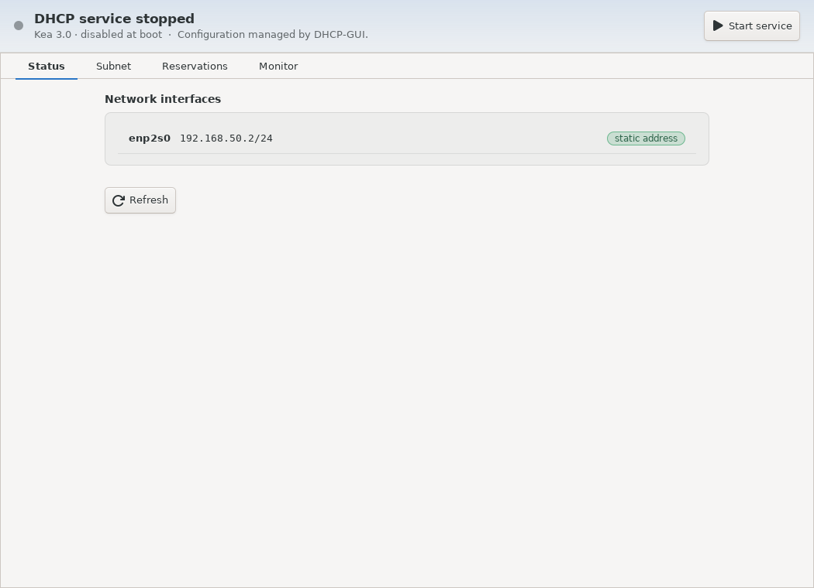
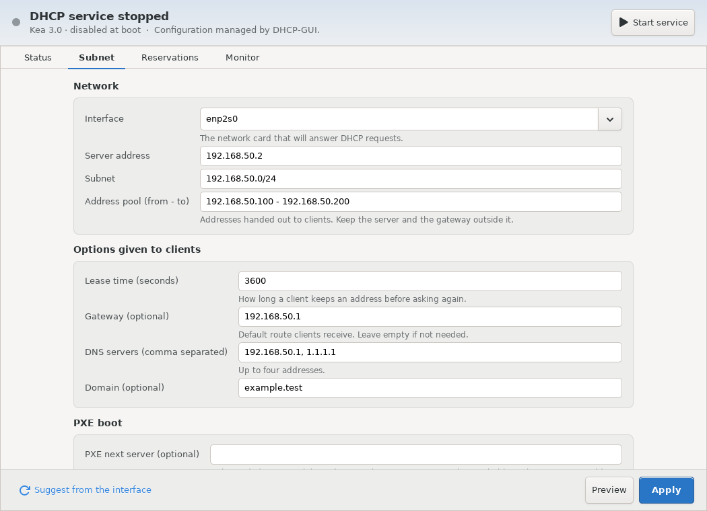
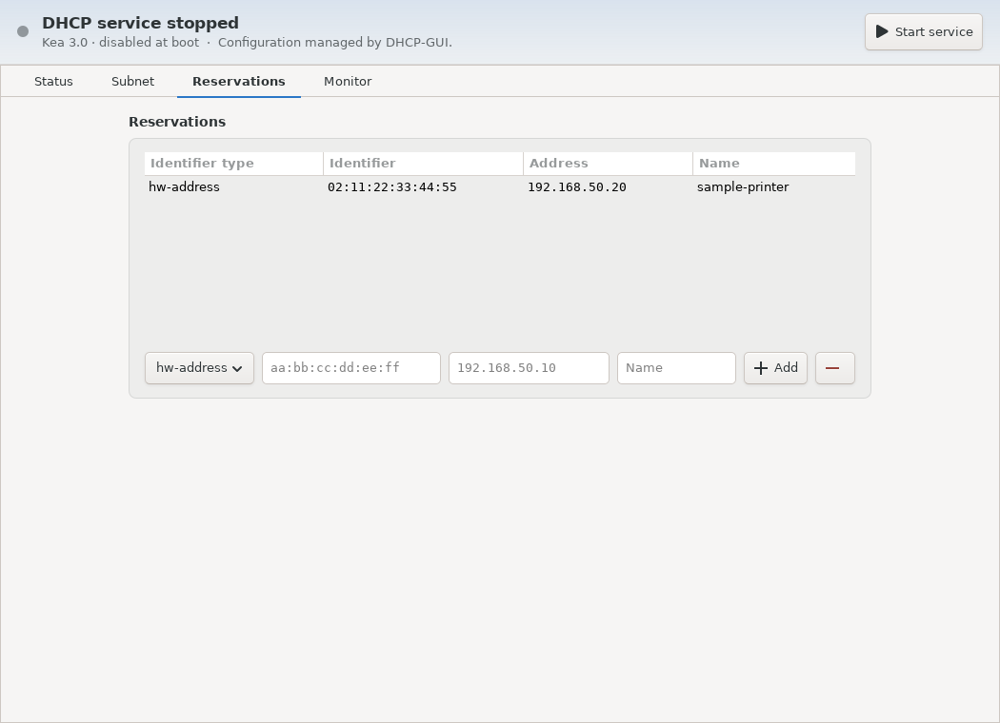

# Dhcp-GUI

A graphical manager for the Kea DHCPv4 server of a Debian-based computer
(Debian 13, SysLinuxOS). Kea stays the DHCP engine and the system service;
Dhcp-GUI configures it without editing JSON.

## Features

- Detects Kea, its version, the service state and the network interfaces, and warns when
  another DHCP server is active on the computer or when an interface gets its address from DHCP.
- Guided setup of a subnet: interface, address pool, lease time, gateway, DNS servers, domain,
  PXE next server and boot file. Pool and addresses are suggested from the interface.
- Static reservations by MAC address or client identifier, checked against the pool and the subnet.
- Preview of the generated Kea configuration before applying.
- Safe apply: the configuration is checked by Kea, the previous files are backed up and
  restored automatically if anything fails. The service is never stopped by an error.
- Start and stop of the service with confirmation, pool usage and the lease list.
- Italian and English interface.

Configurations written by hand and not covered by the supported options are shown
read-only. A supported custom configuration can be adopted after confirmation; the original
Kea file is never modified (the app uses its own file in `/etc/kea/managed/`).
For configurations with multiple subnets, the guided form shows only the first and stays
read-only until it supports editing all of them.

## Screenshots

These screenshots show the interface with example network addresses and devices.

**Status** — service state and available network interfaces.



**Subnet** — address pool, lease time and options sent to clients.



**Reservations** — fixed addresses assigned by device identifier.



## Installation

On Debian 13, SysLinuxOS or a compatible system, add the [SysLinuxOS-Tools APT repository](https://github.com/fconidi/SysLinuxOS-Tools#installation-client-side), then run:

```bash
sudo apt update
sudo apt install dhcp-gui
```

Alternatively, download the [dhcp-gui 0.1.3 Debian package](https://github.com/fconidi/Dhcp-GUI/releases/download/v0.1.3/dhcp-gui_0.1.3_all.deb), then install it from the download directory:

```bash
sudo apt install ./dhcp-gui_0.1.3_all.deb
```

Other versions are listed on the [Releases page](https://github.com/fconidi/Dhcp-GUI/releases).

## Requirements

`kea-dhcp4-server`, Python 3.11+, GTK 3 and polkit. Installing the package pulls them in.
Kea's default configuration does not serve any network until you apply a subnet and start the service.

## Use

Start **Dhcp-GUI** from the SysLinuxOS Tools menu, or run `dhcp-gui`. The service and interface
status is shown without a password. Unlocking the configuration and reading statistics or leases
asks for the administrator password once for a few minutes; every change asks for it each time.

Make sure no other DHCP server is active on the same network before starting the service.

## Not included

DHCPv6, relay, high availability, dynamic DNS and database back ends.

## License

GPL-3.0-or-later.
